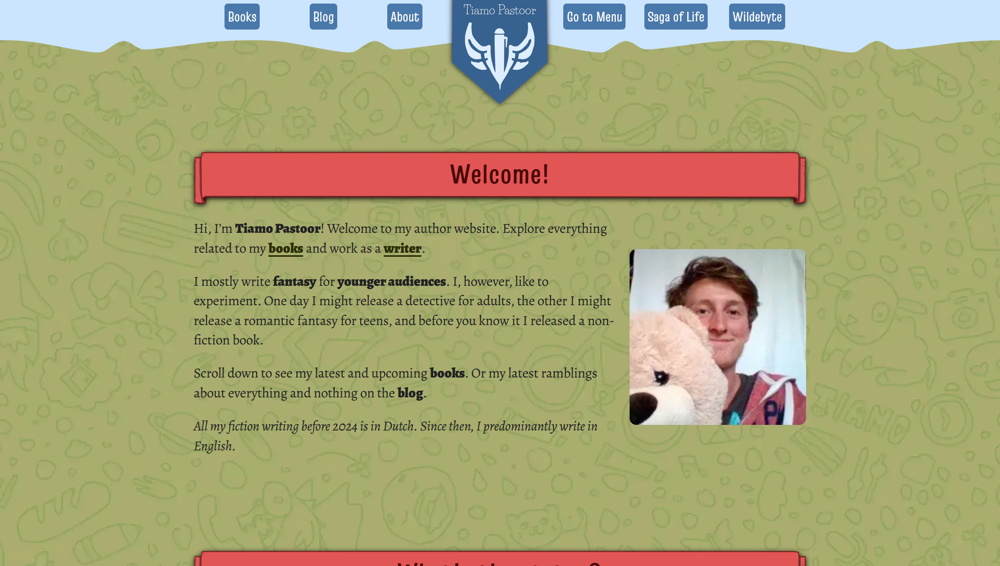
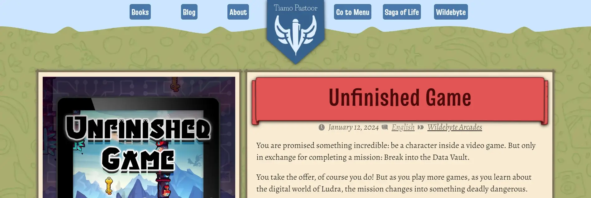

# Tiamo Pastoor

This is the full source code / project behind [Tiamo Pastoor](https://tiamopastoor.com). It's the author website and personal blog of the author Tiamo Pastoor.

## What Is It?

The website contains ...

* **BOOK PAGES:** Images + description of all published books, including price, details, links to bookstores for purchase, etcetera.
* **PROGRESS UPDATES:** A big fat word counter tracking active projects and words written each week.
* **WRITER'S DIARIES:** Diaries about the process of writing each book, which I write anyway to sort my thoughts and might as well publish.
* **PERSONAL BLOG:** Updates about my life, thoughts about stuff happening in the world, reviews of books/series/films/games

## Project Structure

It's made using Hugo. That means it's a static website that rebuilds automatically whenever this repository is updated.

The actual website is inside `tiamopastoor`. Everything else is metadata or supportive documents for the project.

The website has three root sections. 

* `blog` (which mostly contains my old Dutch blog for now)
* `books` (the books I wrote and upcoming ones)
* `diary` (the diaries I keep while writing a story)

Nothing is hidden or changed for this public version. If you don't want spoilers for upcoming books or projects, don't dive too deep ;)

I'm open sourcing all my websites in an effort towards an open world based on sharing and transparency. It's the least I can do.

## Changelog

My personal blog started as a WordPress website. I migrated to HUGO + Markdown files + much cleaner code in general around 2023. 

I spent many days fixing all the issues and checking all the content, but there might be some older article or part of the website with some corrupted text or broken widget.

Otherwise, nothing was lost in the migration. That's probably why the website has over 1000 pages (articles + books) manually written over the span of 10 years, and why it's visited more often than ever thought when I started ;)